<p align="center">
  
</p>

<p align="center">
  <a href="https://github.com/midasvo/ephyra/releases/latest"></a>
  <a href="https://github.com/midasvo/ephyra/releases"></a>
  <a href="https://github.com/midasvo/ephyra/issues"></a>
  <a href="https://jellyfin.org/"></a>
  <a href="LICENSE"></a>
</p>
<p align="center">
  <a href="#install"></a>
  <a href="#android-tv"></a>
</p>
<p align="center">
  <a href="https://midasvo.nl/ephyra/">Website</a> ·
  <a href="#install">Install</a> ·
  <a href="#what-ephyra-adds-to-findroid">What Ephyra adds</a> ·
  <a href="#tablet">Tablet</a> ·
  <a href="#android-tv">Android TV</a> ·
  <a href="#bugs-and-contributions">Bugs and contributions</a> ·
  <a href="#privacy">Privacy</a>
</p>

Ephyra is a Jellyfin client for Android phones, tablets and Android TV, forked from
[Findroid](https://github.com/jarnedemeulemeester/findroid). It needs a
[Jellyfin](https://jellyfin.org/) server, and Android 10 or newer on phones and tablets or
Android 9 or newer on TV.

<table>
  <tr>
    <td width="33%" align="center">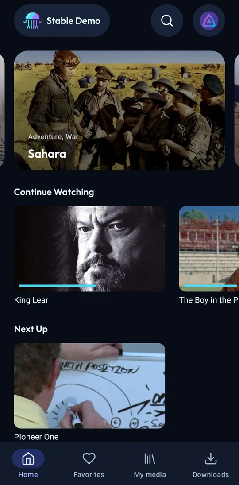<br><sub>Home</sub></td>
    <td width="33%" align="center">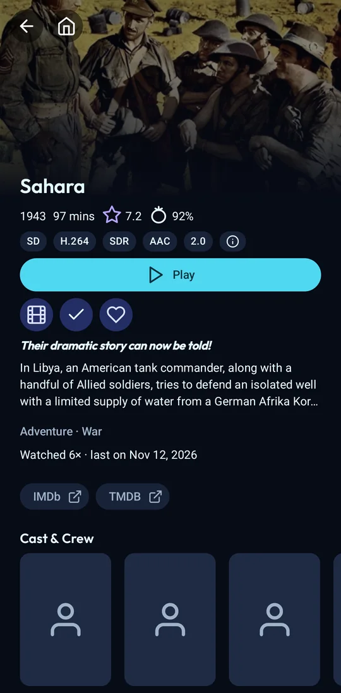<br><sub>Movie page</sub></td>
    <td width="33%" align="center">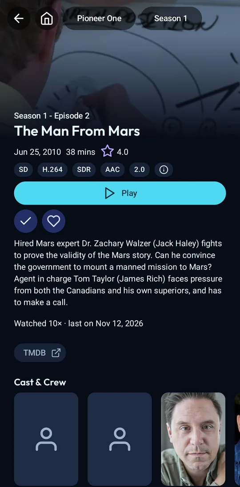<br><sub>Episode page</sub></td>
  </tr>
  <tr>
    <td align="center">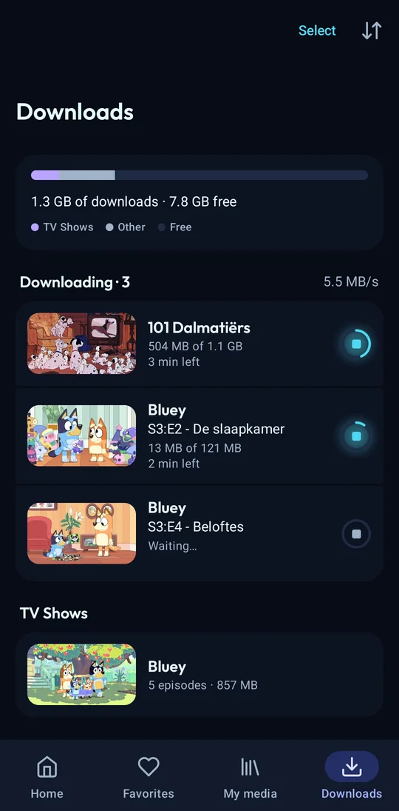<br><sub>Downloads, with a storage breakdown</sub></td>
    <td align="center">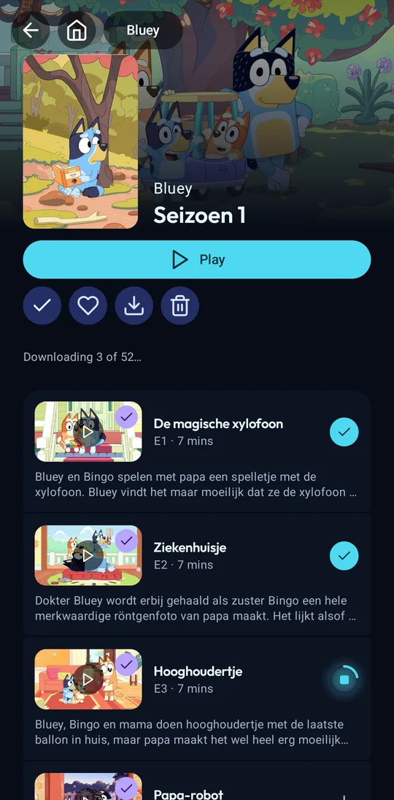<br><sub>Download progress per episode</sub></td>
    <td align="center">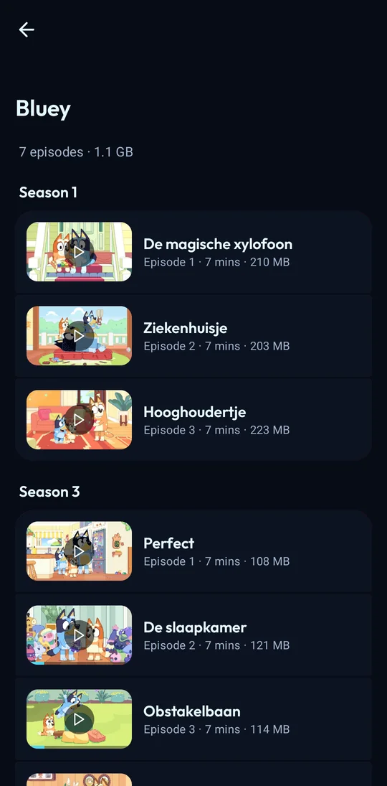<br><sub>A page per downloaded show</sub></td>
  </tr>
  <tr>
    <td align="center">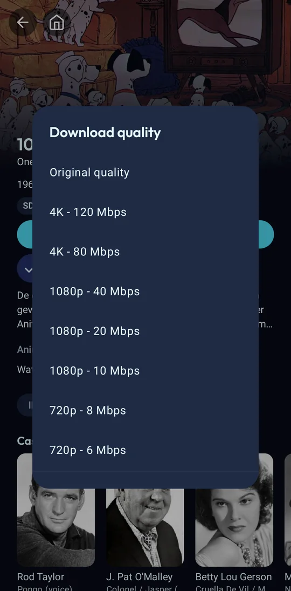<br><sub>Every download asks for a quality</sub></td>
    <td align="center">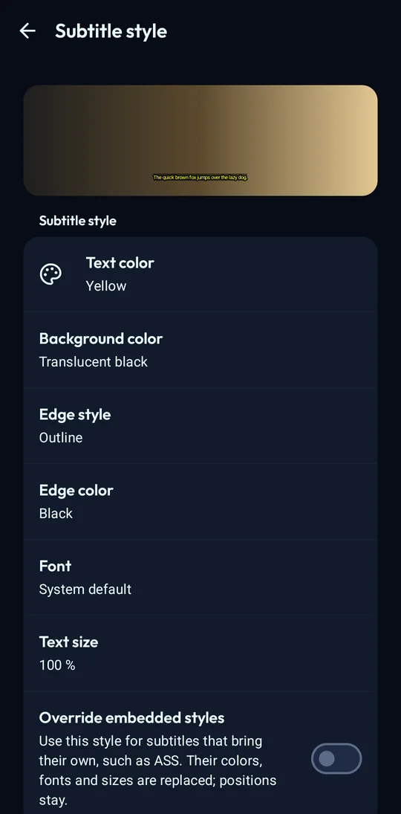<br><sub>Subtitle styling, with a live preview</sub></td>
    <td align="center">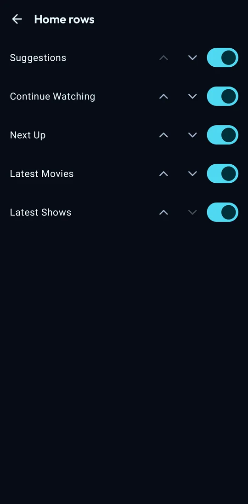<br><sub>Choose and order the Home rows</sub></td>
  </tr>
  <tr>
    <td colspan="3" align="center">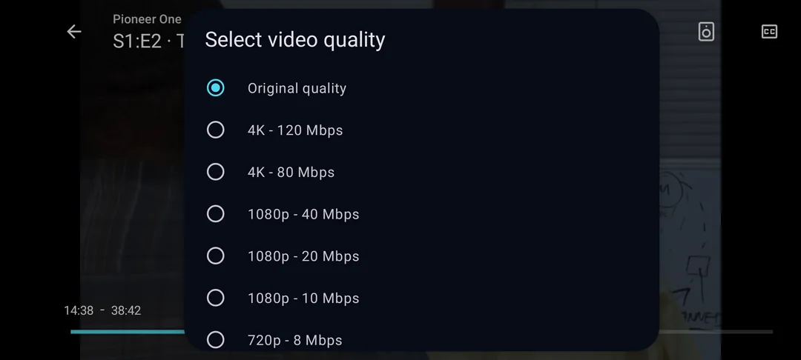<br><sub>Change the video quality during playback</sub></td>
  </tr>
</table>

<sub>Screenshots use the public-domain library of the Jellyfin demo server. All artwork shown belongs to its respective owners.</sub>

## Install

### Two variants

The phone app comes in two variants with the same application ID and the same signing key, so one
installs over the other and keeps your login, settings and downloads.

- **libre**: no Google code.
- **proprietary**: libre plus Google Cast (Chromecast), which needs Google Play services. Without
  them it still runs; Cast is just unavailable.

Every GitHub release and beta has both, so Obtainium can follow either. The Android TV app is libre
only. Stores are coming soon: F-Droid and the Amazon Appstore with libre, Google Play with proprietary on
phones and libre on Android TV.

### Obtainium

Add `https://github.com/midasvo/ephyra` in [Obtainium](https://github.com/ImranR98/Obtainium).
Leave **Include prereleases** off and set **Filter APKs by regular expression**. A release has more
than one APK, so without a filter Obtainium asks which one to install.

| Device | Filter |
|---|---|
| Phone or tablet, libre | `-libre-arm64-v8a\.apk$` |
| Phone or tablet, proprietary (Cast) | `-proprietary-arm64-v8a\.apk$` |
| Android TV, 64-bit | `.*-tv-arm64-v8a\.apk` |
| Android TV, 32-bit (Xiaomi Mi Box and similar) | `.*-tv-armeabi-v7a\.apk` |

### Releases page

Download from [Releases](https://github.com/midasvo/ephyra/releases):
`ephyra-v<version>-libre-<abi>.apk` or `ephyra-v<version>-proprietary-<abi>.apk` for phones and
tablets, `ephyra-v<version>-libre-tv-<abi>.apk` for Android TV. Nearly everything is `arm64-v8a`;
32-bit TV boxes need `armeabi-v7a`.

### F-Droid

[Submitted](https://gitlab.com/fdroid/fdroiddata/-/merge_requests/56048), waiting for review. The
build is reproducible and verified against the GitHub APKs, so once listed you can switch sources
without reinstalling.

### Coming from Findroid CE or Findroid

- Ephyra was Findroid CE until 2.0.0. The update installs over it and keeps your login, settings and
  downloads. An Obtainium entry for `midasvo/findroid-ce` keeps working; GitHub redirects it.
- Ephyra has its own application ID (`nl.midasvo.findroid.ce`), so it installs next to Findroid.
  Phone and TV share that ID.

### Beta

Every push to `main` publishes a prerelease, `v<next version>-beta.<n>`. It installs as a separate
app, **Ephyra Beta**, with its own data. Untested; expect bugs.

Obtainium: add the repository URL again with **Include prereleases** on, **Filter release titles by
regular expression** `^Beta`, and **Filter APKs by regular expression**
`-beta\.\d+-libre-arm64-v8a\.apk$` (with Cast: `-beta\.\d+-proprietary-arm64-v8a\.apk$`; TV, 32-bit:
`-beta\.\d+-libre-tv-armeabi-v7a\.apk$`). The title filter stops the entry from switching to stable right after a release.

## What Ephyra adds to Findroid

**Downloads**

- Resumable, with SD card support. Built on OkHttp, not Android's DownloadManager.
- A quality per download: the original, or a server conversion from 4K down to 360p.
- Whole seasons or series at once, or only their unwatched episodes, with a limit on concurrent
  downloads.
- Downloads screen with progress per episode and per show, a storage breakdown, multi-select and undo.
- Smart Downloads (opt-in): keeps the next episodes of what you're watching, removes them once watched.
- In step with the server: what you watch offline is sent when you're back and moves up in Continue
  Watching, and progress made on your other devices reaches your downloads.

**Playback**

- Dolby Vision direct play where the device supports it, transcoding where it doesn't. Dolby Vision
  downloads can be converted to a device-compatible copy.
- Platform decoder first (Atmos), ffmpeg if a decoder fails.
- PGS, VobSub and DVB subtitles without transcoding. Subtitle colour, outline, font and size, on
  ExoPlayer and mpv, with a switch to override a track's own styling.
- Subtitle sync during playback: move subtitles earlier or later, or line one up with what is said.
- Version picker before playing, quality switch during playback.
- Audio and subtitle choice remembered per series and per user, on ExoPlayer, mpv and downloads.
- Plays on into the next season. Shuffle a show or a season. Chapter list. Skip, ask or ignore per media segment type.
  "Still watching?" prompt after a run of autoplayed episodes.
- "Up next" card with a countdown at the end of an episode. Sleep timer.
- Background audio with lock screen controls (opt-in, Settings → Player → Background playback).

**Cast**

- Google Chromecast: pick a device from the top bar and cast from any item. A mini player and a
  remote control player (seek, previous and next, volume, audio and subtitle tracks, skip segments)
  take over. Phone and tablet only, in the proprietary variant ([Install](#two-variants)).

<table>
  <tr>
    <td width="33%" align="center">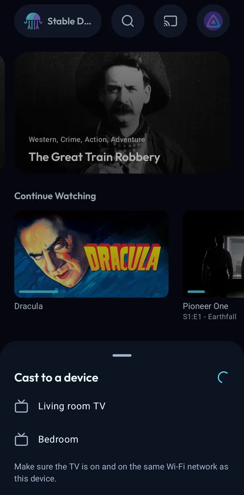<br><sub>Pick a device from the top bar</sub></td>
    <td width="33%" align="center">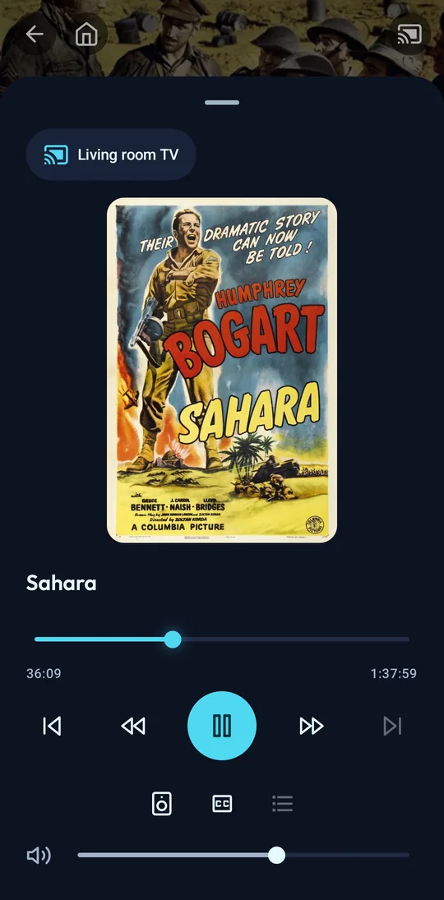<br><sub>The phone becomes the remote</sub></td>
    <td width="33%" align="center">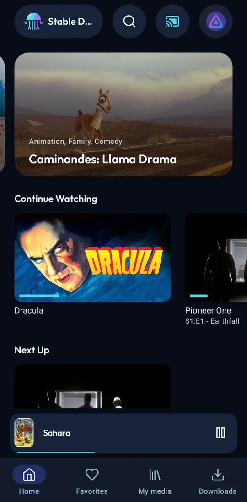<br><sub>A mini player while you browse</sub></td>
  </tr>
  <tr>
    <td colspan="3" align="center">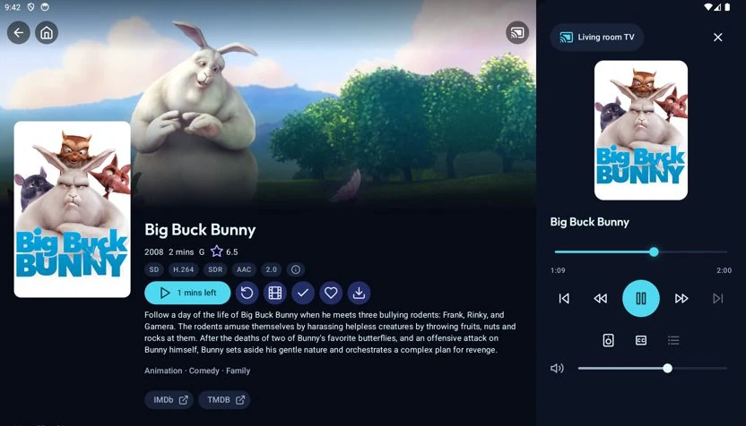<br><sub>On a tablet the Cast player sits beside the page</sub></td>
  </tr>
</table>

**Library**

- Favorites tab.
- Home rows you choose and reorder (Settings → Interface → Home rows).
- Hide-watched filter, kept across libraries.
- When the server doesn't answer, a banner says so and leads to your downloads, which open and
  play without it. It goes by itself when the server is back.
- Error screens with Retry, and real empty states.
- Long-press to copy text on detail screens. Option to hide cast and crew.
- HDR10+ and Dolby Atmos badges on movie and episode pages.
- Movie and show pages with the critic score, tagline, studios, every trailer, extras,
  collections and "More like this", each with a switch (Settings → Interface → Detail pages).
- Profiles: user faces, default avatars and one-tap switching between users. A profile can be
  locked with a PIN, or a pattern on the phone, kept on the device.

**Look**

- Its own identity: deep navy, cyan for what is playing, downloading or focused, violet for what
  is yours (favorites, watched, ratings), the Outfit typeface and pill buttons.
- Material You dynamic colours are an option (off by default).

**Tablet**: the same app, laid out for the width, [below](#tablet).

**Android TV**: a separate app built for the remote, [below](#android-tv).

The rest is Findroid's, and Findroid's changes are merged in regularly. Release-by-release detail
is in the [changelog](CHANGELOG.md).

## Tablet

<table>
  <tr>
    <td colspan="2" align="center">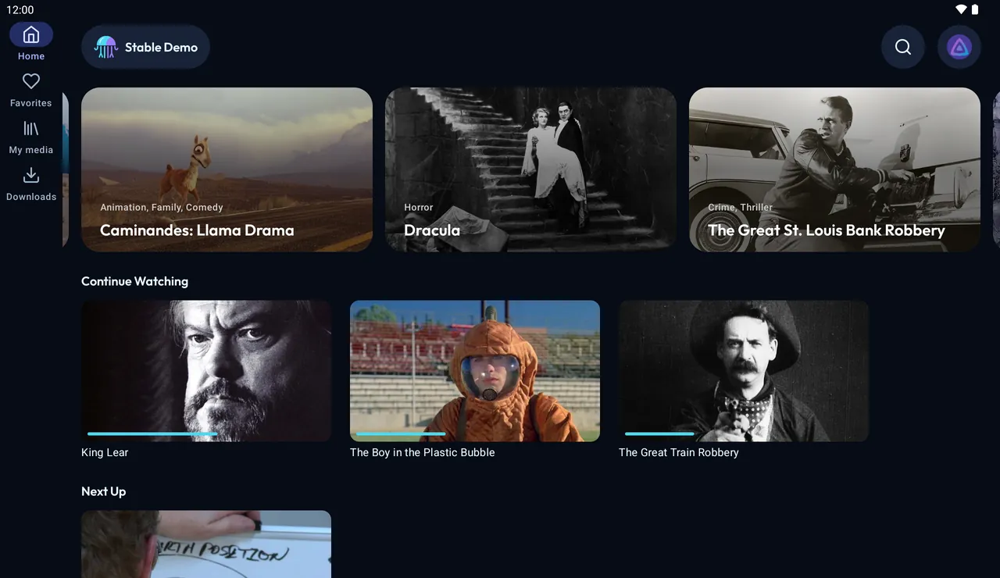<br><sub>Home with a navigation rail and a wider carousel</sub></td>
  </tr>
  <tr>
    <td width="50%" align="center">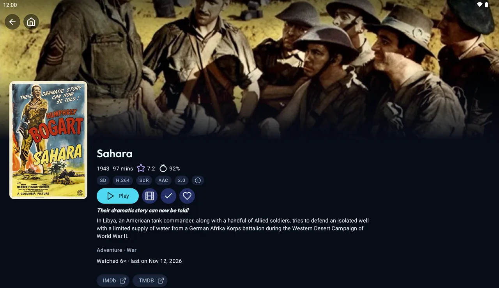<br><sub>Item pages with a hero and the poster beside the text</sub></td>
    <td width="50%" align="center">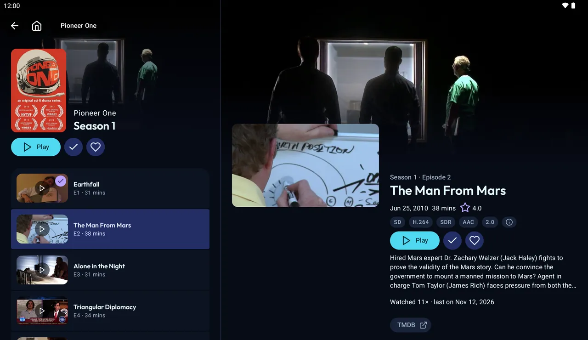<br><sub>Seasons as list and detail side by side</sub></td>
  </tr>
  <tr>
    <td align="center">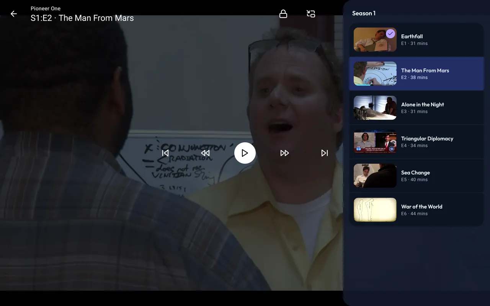<br><sub>Episode panel in the player</sub></td>
    <td align="center">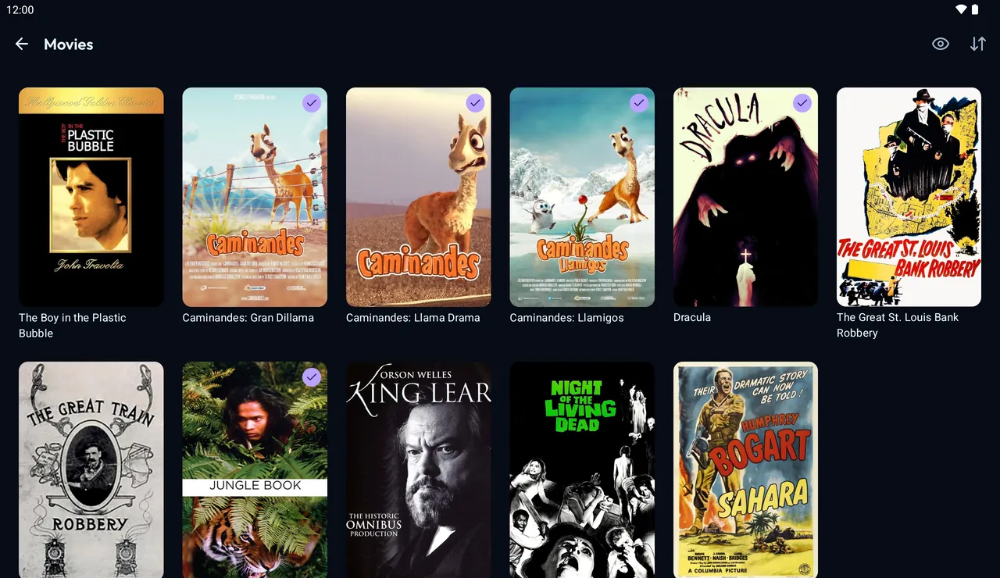<br><sub>Grids use the width</sub></td>
  </tr>
</table>

The phone app, laid out for the window rather than the device, so a tablet, an unfolded foldable, a
split-screen half and a desktop window each get what fits:

- Navigation rail from 600 dp. Home shows two or three carousel pages and wider cards.
- Movie, show and episode pages put the poster and the text beside each other over a full-width
  backdrop; text never runs wider than it can be read.
- Seasons open as a list with the selected episode beside it on a landscape tablet. An episode
  opened from Home or search lands in the same place.
- Player: plays in the orientation you hold the tablet in, volume and brightness swipes only near
  the edges, roomier controls, an episode panel, and a keyboard map (Space, arrows, M, L, Esc) and
  mouse support.
- Foldables: in tabletop posture the video sits above the fold and the controls below it.
- Downloads in two columns, settings and forms at a readable width.

Design and test sizes: [docs/tablet/](docs/tablet/).

## Android TV

<table>
  <tr>
    <td colspan="2" align="center">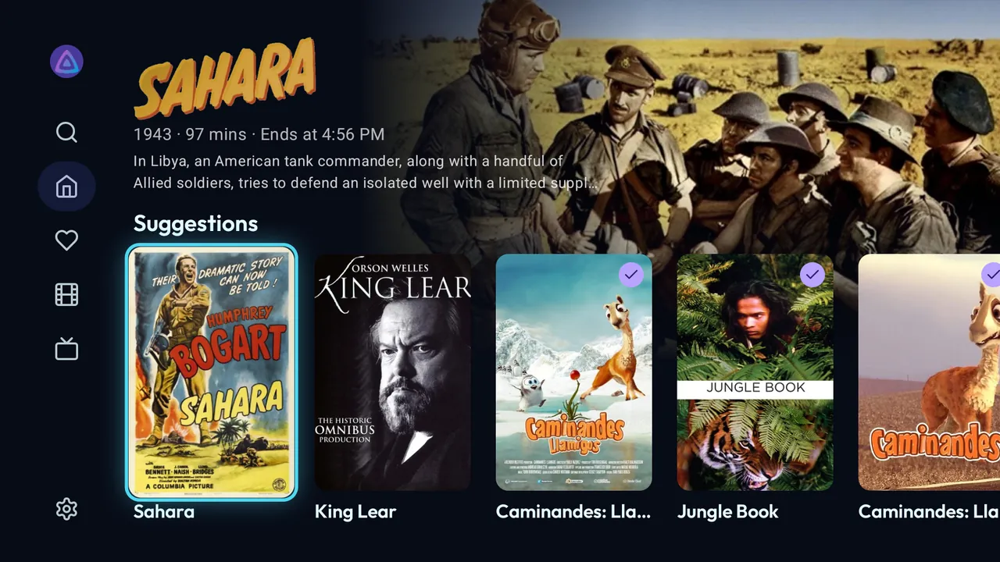<br><sub>Home, with a hero and a glow for the focused item</sub></td>
  </tr>
  <tr>
    <td width="50%" align="center">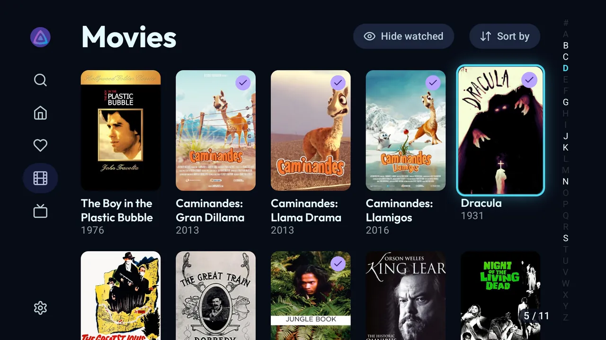<br><sub>Library grid with an A to Z jump bar</sub></td>
    <td width="50%" align="center">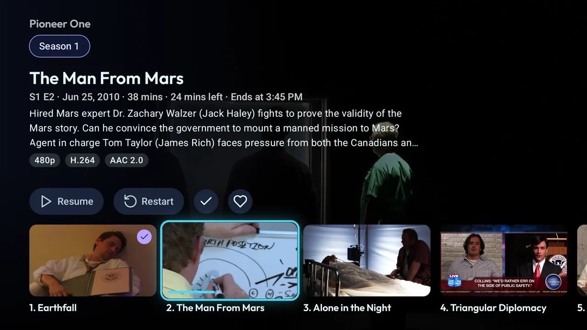<br><sub>Episodes open in their season</sub></td>
  </tr>
  <tr>
    <td align="center">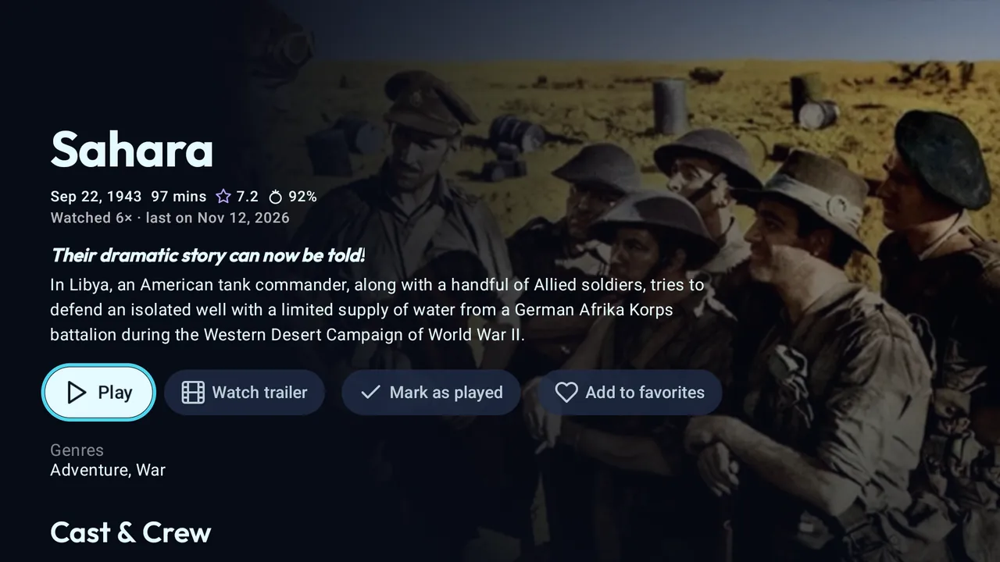<br><sub>Movie page</sub></td>
    <td align="center">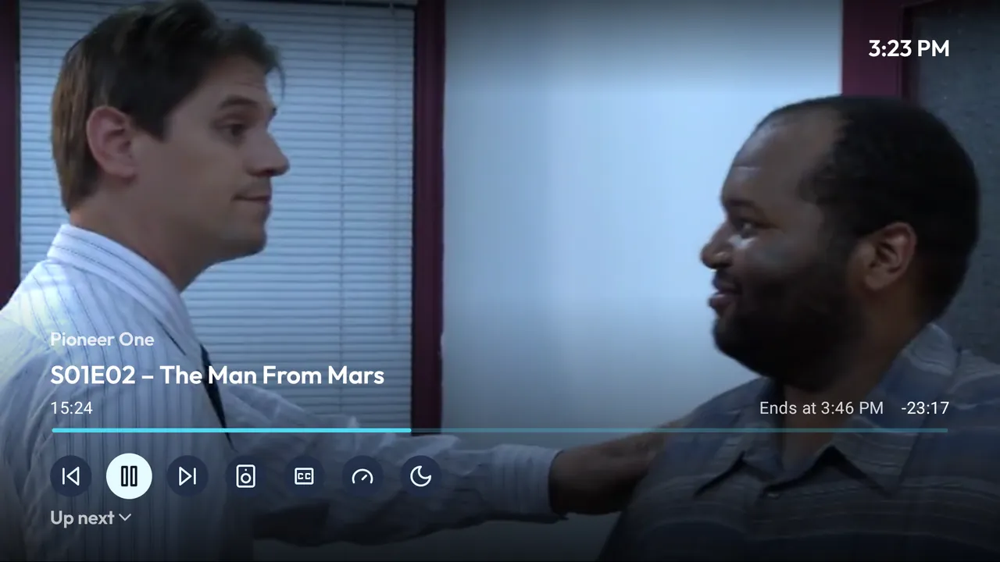<br><sub>Player overlay</sub></td>
  </tr>
  <tr>
    <td colspan="2" align="center">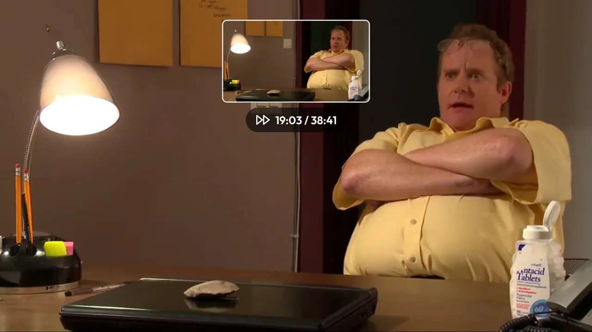<br><sub>Trickplay thumbnails while seeking</sub></td>
  </tr>
</table>

Same login and server as the phone app, same releases (the `-tv-` APKs). Built for the remote:

- Side drawer: Search, Home, Favorites, your libraries, Settings.
- Home with a hero for the focused item. Rows stay put; you choose and order them.
- Library grid with an A to Z jump bar, a counter and the hide-watched filter.
- Episodes open in their season, details first. Cast rows and person pages.
- Player: D-pad seeking, media keys, trickplay thumbnails, an overlay with the series, end time,
  previous, next and the queue. Subtitle sync.
- Refresh rate switching to match the video.
- Continue Watching and Next Up in the Android TV home screen's Watch Next row.
- Screensaver with your library's artwork. Optional theme music on show pages.
- Sleep timer, "Up next" card and profile PIN, as on the phone.
- Collections, trailers and settings all reachable with the remote. Phone-only settings are hidden.

Background and roadmap: [docs/tv-research/](docs/tv-research/).

## Bugs and contributions

[Open an issue](https://github.com/midasvo/ephyra/issues). For playback problems, attach the device
profile from About → Export device profile.

Pull requests are welcome: [CONTRIBUTING.md](CONTRIBUTING.md) has the build, the checks and the
conventions, and [docs/](docs/README.md) the design documents.

```bash
./gradlew :app:phone:assembleLibreDebug
```

Strings shared with Findroid are translated on Findroid's Weblate. Ephyra's own live in
`strings_ce.xml` files, in 36 languages; fixes go in a pull request.

## Privacy

Ephyra collects nothing and only talks to the Jellyfin servers you add.
[Privacy policy](https://midasvo.nl/ephyra/privacy.html).

## Thanks

[Findroid](https://github.com/jarnedemeulemeester/findroid) by
[Jarne Demeulemeester](https://github.com/jarnedemeulemeester) and its
[contributors](https://github.com/jarnedemeulemeester/findroid/graphs/contributors).

An ephyra is a young jellyfish, the animal in the Jellyfin logo. The icon and banner were made for
this project: [images/branding/ephyra/](images/branding/ephyra/).

## License

[GPLv3](LICENSE). The Outfit font is used under the
[SIL Open Font License 1.1](core/OUTFIT-LICENSE.txt).
