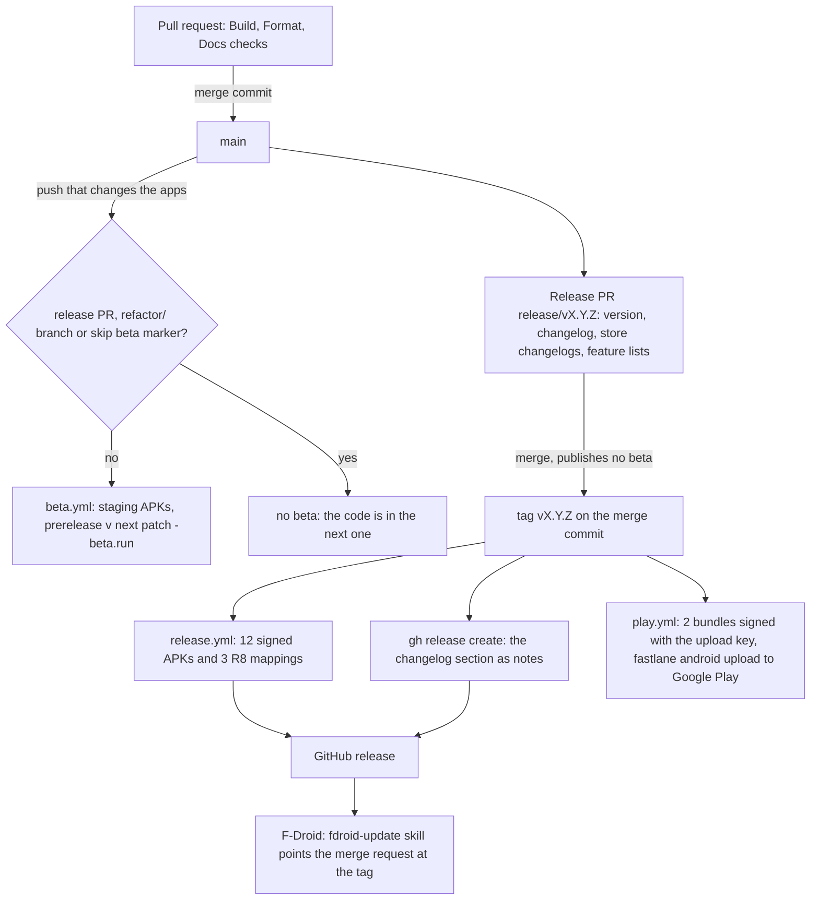

# Releases, stores and upstream sync

Status: betas and releases are published by workflows, and a release tag also builds the Google Play bundles and uploads them (#1058); the F-Droid merge request is done by hand after each release. The latest release is v2.9.0. As of 2026-11-24 (`main` at `0412c8efc`).

## Start here

- The version is `EphyraVersion` in `buildSrc/src/main/kotlin/EphyraVersion.kt`: `NAME`, `CODE` and `TV_CODE`. Only a release PR changes them; the build fails when the three disagree.
- A push to `main` publishes a beta through `.github/workflows/beta.yml`. A tag `vX.Y.Z` publishes a release through `.github/workflows/release.yml`, and starts `.github/workflows/play.yml`, which builds the Play bundles and uploads them to Google Play. Nothing else publishes: F-Droid is a step a person or the `release` skill takes afterwards.
- The procedures are the skills, not this guide: `.claude/skills/release/SKILL.md`, `.claude/skills/fdroid-update/SKILL.md` and `.claude/skills/upstream-sync/SKILL.md`. Read the one you need before you change anything here; this guide says how the parts fit.
- A beta is another app (`nl.midasvo.findroid.ce.staging`, "Ephyra Beta") that installs next to the stable one. It is the `staging` build type, minified like the release.
- Test without releasing: `./gradlew :app:phone:assembleLibreStaging` builds what a beta builds, and `bash .claude/skills/release/scripts/next-version.sh` prints the next version. See "How to test it".

## The chain



### From a merge to a beta

`beta.yml` runs on a push to `main` and on `workflow_dispatch`. Three things decide whether a push publishes a beta.

**Paths.** A push that touches only these publishes nothing, because none of them is in an APK: `docs/**`, `site/**`, `devsite/**`, `**.md`, `images/**`, `fastlane/**`, `.claude/**`, `.github/ISSUE_TEMPLATE/**`, `.github/FUNDING.yml` and `LICENSE`. `build.yaml` has the same list, with `.claude/skills/translate-strings/**` put back because it runs that skill's check. A change to a workflow file is not on the list: it does publish a beta, unless the merge commit says otherwise.

**The merge commit's message.** The `prepare` job is skipped, and with it every other job, when the head commit's message contains one of:

| Marker | Which merges have it | Why |
|---|---|---|
| `/release/v` | a release PR ("Merge pull request #N from midasvo/release/vX.Y.Z") | that code is the stable release, and the beta before it already has all of it |
| `/refactor/` | a PR from a `refactor/` branch | nothing a beta user can see changed (#733) |
| `[skip beta]` | a tests-only or CI-only PR, or an upstream sync without translations, merged with `gh pr merge <pr> --merge --body "[skip beta]"` | the same |

The markers are matched anywhere in the message, and only for a push: a manual run always builds.

**By hand.** `gh workflow run beta.yml -f pr=<number>` builds an open PR merged into its base; `gh workflow run beta.yml --ref <branch>` builds a branch as it is. A PR from a fork is refused, because the build jobs see the keystore. So is a PR that is closed or has conflicts.

What a beta run does: `prepare` reads `NAME` and computes the tag `v<next patch>-beta.<run number>` (v2.9.1-beta.N after the 2.9.0 release). `build` assembles three apps in parallel (`:app:phone:assembleLibreStaging`, `:app:phone:assembleProprietaryStaging`, `:app:tv:assembleLibreStaging`) with `BETA_BUILD` set to the run number. `notes` writes "New since vX.Y.Z" from the merged PRs with `.github/scripts/beta-changelog.sh`. `publish` creates a prerelease with the APKs and the R8 mappings, then deletes all but the newest three betas and their tags (`KEEP_BETAS`). One beta runs at a time (the `beta-release` concurrency group).

### From main to a release

The `release` skill has every step. In short:

1. Start from `origin/main` with green checks, and run the skill's smoke test on the newest beta (step 1b).
2. Pick the version (below) and let the maintainer confirm it.
3. Open the release PR from a branch `release/v<version>`: the three literals in `EphyraVersion.kt`, the new section in [`CHANGELOG.md`](../../CHANGELOG.md), the store changelogs `fastlane/metadata/android/en-US/changelogs/<CODE>.txt` and `<TV_CODE>.txt`, and the feature lists (`docs/features.yaml`, the README, the site).
4. Merge it with a merge commit. That push publishes no beta.
5. Tag the merge commit `v<version>` and push the tag. Create the GitHub release at once, with the changelog section as its notes.
6. `release.yml` starts on the tag (the pattern is `v[0-9]+.[0-9]+.[0-9]+`, matched against the whole tag, so a beta tag never starts it). It builds `:app:phone:assembleLibreRelease`, `:app:phone:assembleProprietaryRelease` and `:app:tv:assembleLibreRelease`, appends the "Which APK?" text to the notes and attaches the files, with a checksum file and a provenance attestation for the APKs (#977).
7. `play.yml` starts on the same tag. It builds `:app:phone:bundleProprietaryRelease` and `:app:tv:bundleLibreRelease` with the upload key, keeps them and their R8 mappings as the `play-bundles` artifact, and uploads them with `fastlane android upload` to the track, release status and TV choice in the repository variables `PLAY_TRACK`, `PLAY_RELEASE_STATUS` and `PLAY_TV`. It is a workflow of its own so that a Play failure never holds up the release; without the Play secrets it skips what it can't do and says so in its summary ([`play-store.md`](../play-store.md), "In CI").
8. Run the `fdroid-update` skill, then report.

## The version

[`EphyraVersion.kt`](../../buildSrc/src/main/kotlin/EphyraVersion.kt) holds three literals that change together:

| Constant | Value | Used for |
|---|---|---|
| `NAME` | `X.Y.Z`, with Y and Z below 100 | `versionName`, the tag `v<NAME>` |
| `CODE` | `X * 1_000_000 + Y * 10_000 + Z * 100` | the phone's `versionCode` |
| `TV_CODE` | `CODE + 1` | the TV app's `versionCode` in the `release` build type |

2.9.0 is `2090000` and `2090001`. The object's `init` block checks both numbers against `NAME`, so a wrong literal stops every Gradle build. `CODE` is a literal and not computed because F-Droid's update check reads it from the file with a regex. The TV code sits one above the phone code because phone and TV share one application ID ([TV ADR 0005](../tv-research/adr/0005-application-id.md)): Play needs a unique code per upload. `EphyraVersion.NEXT_PATCH` is the version a beta counts towards. Upstream's `Versions.APP_NAME` and `Versions.APP_CODE` are not used.

A beta has its own numbers: `versionCode` is `1_000_000 + <run number>` for phone and TV alike, and `versionName` is `<NEXT_PATCH>-beta.<run number>`. They are lower than the stable codes, which does not matter: the beta is another application ID.

**The next version** follows from the conventional commits since the last `vX.Y.Z` tag (X of 2 or more), merge commits left out. `.claude/skills/release/scripts/next-version.sh` applies it and prints the reason on stderr:

| Commits since the last release | Next version |
|---|---|
| a `type!:` subject or `BREAKING CHANGE` in a body | major |
| a `feat` | minor |
| anything else | patch |
| none | an error: nothing to release |

The script cannot see what a commit means for users, so the maintainer has the last word: a `fix` that resets a setting is breaking, a `feat` that only touches CI is a patch. This is why `feat` is only for something a user gets (`AGENTS.md`).

Tags below `v2` are Findroid's, and `v1.2.0-ce.N` are the old Findroid CE releases. Never reuse or move them.

## Flavours, build types and channels

`app/phone` has the flavours `libre` (the default, no Google code) and `proprietary` (with Google Cast). `app/tv` has only `libre`. Both apps have the build types `debug`, `release` and `staging`; `staging` starts as a copy of `release` (`initWith`), so it is minified and signed the same way.

| Build type | Application ID | App name | Version name |
|---|---|---|---|
| `debug` | `nl.midasvo.findroid.ce.debug` | Ephyra Debug | `NAME` |
| `staging` | `nl.midasvo.findroid.ce.staging` | Ephyra Beta | `<NEXT_PATCH>-beta.<run>` in the Beta workflow, `<NAME>-staging` when built without `BETA_BUILD` |
| `release` | `nl.midasvo.findroid.ce` | Ephyra | `NAME` |

The flavours change neither the application ID nor the key, so `libre` and `proprietary` install over each other and keep the login. So do the phone and TV APKs of one build type.

| Channel | Phone | TV | Built by |
|---|---|---|---|
| GitHub release | `libre` and `proprietary`, `release` | `libre`, `release` | `release.yml` |
| GitHub beta (prerelease) | `libre` and `proprietary`, `staging` | `libre`, `staging` | `beta.yml` |
| F-Droid | `libre`, `release`, `arm64-v8a` only | not on F-Droid | F-Droid, from the tag |
| Google Play | `proprietary` bundle (#641) | `libre` bundle on the track `tv:<track>` | `play.yml` (#1058), or `fastlane android deploy` by hand |
| Amazon Appstore | `libre` | `libre` | by hand; the repository has no upload step for it |

**APK names.** For `release` and `staging` the build files set the name: `ephyra-v<versionName>-<flavour>-<abi>.apk` for the phone and `ephyra-v<versionName>-libre-tv-<abi>.apk` for TV. The ABI splits are `armeabi-v7a`, `arm64-v8a`, `x86` and `x86_64`, so a release has twelve APKs: four each of `-libre-`, `-proprietary-` and `-libre-tv-`. The R8 mappings are attached as `ephyra-<tag>-mapping.txt`, `-proprietary-mapping.txt` and `-tv-mapping.txt`. Debug builds keep the Android Gradle Plugin's default names. A bundle has no ABI splits: the build files turn them off when a task name contains "bundle".

The store listing (title, descriptions, images, a changelog per version code) is `fastlane/metadata/android/en-US/`. Google Play gets it through fastlane; F-Droid reads it from the tagged commit. How the screenshots are made is in [`screenshots.md`](../screenshots.md).

## Signing

Both build files look for a key in two places, in this order:

1. The environment: `KEYSTORE_FILE` (a path), `KEYSTORE_PASSWORD`, `KEY_ALIAS`, `KEY_PASSWORD`. When `KEYSTORE_FILE` is set, the file below is not read.
2. `keystore.properties` in the repository root, with `storeFile`, `storePassword`, `keyAlias` and `keyPassword`. [`keystore.properties.example`](../../keystore.properties.example) is the template; the real file and any `.jks` are in `.gitignore`.

With neither, no `release` signing config exists, and the `release` and `staging` build types are built without one.

**In CI.** `beta.yml` and `release.yml` decode the secret `KEYSTORE_BASE64` to `findroid-ce.jks` in the workspace and pass the secrets `KEYSTORE_PASSWORD`, `KEY_ALIAS` and `KEY_PASSWORD` to Gradle. Only the build jobs of those two workflows see them. `build.yaml` uses no secret: it builds debug variants.

**Google Play** uses Play App Signing with the same release key, and the bundles are uploaded signed with a separate upload key through the same `KEYSTORE_*` variables ([`play-store.md`](../play-store.md), [`fastlane/Fastfile`](../../fastlane/Fastfile)). In CI that key is in its own secrets, `PLAY_UPLOAD_KEYSTORE_BASE64`, `PLAY_UPLOAD_KEYSTORE_PASSWORD`, `PLAY_UPLOAD_KEY_ALIAS` and `PLAY_UPLOAD_KEY_PASSWORD`, which only `play.yml` reads; it decodes the key under `$RUNNER_TEMP`, not in the workspace, with the service account key `PLAY_SERVICE_ACCOUNT_JSON`. **F-Droid** builds the tag itself and compares the result with the `ephyra-v<version>-libre-arm64-v8a.apk` of the GitHub release, which carries our signature.

**What a contributor can build.** Every debug variant, with no key: `./gradlew :app:phone:assembleLibreDebug`, and `:app:phone:assembleProprietaryDebug` or `:app:tv:assembleLibreDebug`. With a keystore of their own in `keystore.properties`, also `release` and `staging` builds, for example to test the minified app. What they cannot build is an APK that updates an installed Ephyra or Ephyra Beta: that needs the release key, which is only in the repository's secrets. For the same reason the Beta workflow never builds a fork's PR.

## The upstream sync and the ledger

Ephyra stays 0 commits behind Findroid: every Findroid commit is in `main`'s history. That does not mean Ephyra has Findroid's code. A sync is a real merge in a PR, in which only the `strings.xml` files that Findroid's Weblate writes take the merge result; everything else stays on Ephyra's side. Each upstream commit that is not a translation gets a row in [`upstream-ledger.md`](../upstream-ledger.md) with a verdict (taken, re-implement, covered, re-implemented, skipped), and a change worth having is built again in a PR of its own. A sync never changes the version, never tags and never touches the changelog; what it brought is listed under **From Findroid** when the next release is written. The steps are in `.claude/skills/upstream-sync/SKILL.md`; [`upstream-sync.md`](../upstream-sync.md) is the short overview.

## Where it is

| Path | What |
|---|---|
| [`buildSrc/src/main/kotlin/EphyraVersion.kt`](../../buildSrc/src/main/kotlin/EphyraVersion.kt) | The version and its checks |
| [`app/phone/build.gradle.kts`](../../app/phone/build.gradle.kts), [`app/tv/build.gradle.kts`](../../app/tv/build.gradle.kts) | Flavours, build types, signing, ABI splits, the beta's version, the APK names |
| [`.github/workflows/beta.yml`](../../.github/workflows/beta.yml) | The Beta workflow; its notes come from [`beta-changelog.sh`](../../.github/scripts/beta-changelog.sh) |
| [`.github/workflows/release.yml`](../../.github/workflows/release.yml) | The Release workflow |
| [`.github/workflows/play.yml`](../../.github/workflows/play.yml) | The Google Play workflow: the bundles and their upload |
| [`.github/workflows/build.yaml`](../../.github/workflows/build.yaml) | The checks of a PR: translations, debug builds, unit tests |
| [`.github/workflows/pages.yml`](../../.github/workflows/pages.yml) | The site, deployed on a push to `main` that changes it; not part of a release |
| [`CHANGELOG.md`](../../CHANGELOG.md) | One section per release: a paragraph, then Added, Changed, Fixed, From Findroid, Maintenance |
| [`fastlane/Fastfile`](../../fastlane/Fastfile), `fastlane/metadata/android/en-US/` | The Play lanes (`deploy` builds and uploads, `upload` only uploads); the listing and the changelog per version code |
| `.claude/skills/release/`, `.claude/skills/fdroid-update/`, `.claude/skills/upstream-sync/` | The procedures and their scripts |
| [`play-store.md`](../play-store.md), [`screenshots.md`](../screenshots.md), [`upstream-sync.md`](../upstream-sync.md), [`upstream-ledger.md`](../upstream-ledger.md) | Google Play, the screenshots, the sync |

## How to test it

Most of this area can be checked without publishing anything.

```bash
# The version literals agree (any Gradle run fails if not), and the next version
./gradlew :app:phone:compileLibreDebugKotlin
bash .claude/skills/release/scripts/next-version.sh

# What a beta builds; needs a keystore (see Signing). With BETA_BUILD the name and code are a beta's
./gradlew :app:phone:assembleLibreStaging :app:tv:assembleLibreStaging
BETA_BUILD=1 ./gradlew :app:phone:assembleLibreStaging

# What Google Play gets
./gradlew :app:phone:bundleProprietaryRelease :app:tv:bundleLibreRelease

# A beta's notes, written to a file (needs the tags and a logged-in gh)
GITHUB_REPOSITORY=midasvo/ephyra bash .github/scripts/beta-changelog.sh HEAD v0.0.0-beta.0 notes.md

# The F-Droid recipe: the diff it would push, and the pipeline's state
python3 .claude/skills/fdroid-update/scripts/update-mr.py --dry-run
python3 .claude/skills/fdroid-update/scripts/update-mr.py --status

# The docs
python3 .claude/skills/start-work/scripts/check-docs.py
```

- **A change to a build file** (signing, splits, names, version codes): build the staging variant and look at the file names in `app/phone/build/outputs/apk/libre/staging/`. Both workflows copy `*.apk` from that kind of folder and one `mapping.txt`, and the publish job fails when either is missing.
- **A change to `beta.yml`:** `gh workflow run beta.yml --ref <branch>` runs the workflow file of that branch. It publishes a real prerelease and removes the oldest of the three kept betas, so say so first and do it once.
- **A change to `play.yml` or the Fastfile:** `gh workflow run play.yml --ref <branch>` runs it with that branch's files. With the Play secrets set it uploads for real, and Play refuses a versionCode it already has, so the upload of a branch that has the released version fails; the build and the artifact still say whether the rest works. Without the secrets, `bundle exec fastlane lanes` checks that the Fastfile loads.
- **A change to `release.yml`** has no dry run: it only starts on a release tag. Its build matrix and steps are the same as the Beta workflow's apart from the Gradle tasks and `BETA_BUILD`, so keep the two alike and test the shared part through a beta.
- **A change to the listing:** a store changelog is plain text of at most 500 characters, one file per version code. The Pages workflow builds the site on a PR that touches `docs/`, `site/` or `devsite/`.
- **Before a release**, the skill's smoke test (step 1b) plays items on the newest beta over http and https, on both player backends.

## Before a PR

- A PR here is usually `docs/<slug>`, or `fix/` or `feat/` when it changes a build file. A PR that changes only a workflow or a test is merged with `[skip beta]`.
- Do not change `EphyraVersion.kt` or `CHANGELOG.md` outside a release PR.
- `python3 .claude/skills/start-work/scripts/check-docs.py`, and `python3 .claude/skills/start-work/scripts/check-guides-follow.py` against `origin/main`: this guide follows the files the map lists for the area.
- A change to a build file runs the Build workflow; wait for it, and for the review bots, before merging (`AGENTS.md`).

## Decisions and history

- [TV ADR 0005](../tv-research/adr/0005-application-id.md): one application ID for phone and TV, hence `TV_CODE`. [TV ADR 0006](../tv-research/adr/0006-release-tv-apk.md): the TV APK in betas and releases, with `-tv-` in its name.
- [#626](https://github.com/midasvo/ephyra/issues/626), [#641](https://github.com/midasvo/ephyra/issues/641): the `proprietary` flavour with Cast; it is the Google Play phone bundle and a second phone APK on GitHub.
- [#172](https://github.com/midasvo/ephyra/issues/172), [#174](https://github.com/midasvo/ephyra/issues/174): the app became Ephyra and the repository `midasvo/ephyra`. The application ID stayed, so installs update.
- [#177](https://github.com/midasvo/ephyra/issues/177): Google Play. [#1058](https://github.com/midasvo/ephyra/issues/1058): the Play bundles built and uploaded in CI, in a workflow of their own.
- [#733](https://github.com/midasvo/ephyra/issues/733): merges of `refactor/` branches publish no beta.
- [#960](https://github.com/midasvo/ephyra/issues/960): the smoke test before a release.

## Pitfalls

- **A beta tag must never match the release pattern.** `beta.yml` stops when its tag would be a bare `vX.Y.Z`, and `release.yml` matches the whole tag. Keep both when touching either.
- **The skip condition is written twice in `beta.yml`**, on the concurrency group and on `prepare`. Its comment says to keep them the same: a skipped push in the shared group would drop a beta that is waiting.
- **Code from a `refactor/` or `[skip beta]` merge is in no beta until another PR publishes one.** The smoke test checks `git log <beta tag>..origin/main` and builds the staging variant itself when the newest beta is behind (`release` skill, step 1b).
- **2.9.0 shipped with every test done on a debug build over http** (#960). The debug build is not minified; the beta and the release are.
- **`gh pr merge --auto` merges at once**, because `main` has no required checks. Wait for the checks yourself, also on a release PR.
- **Create the GitHub release with `--notes-start-tag`.** Without it GitHub compares with Findroid's v1.0.2, inherited with the fork, and lists every PR since the fork. `release.yml` appends to the notes for the same reason and generates none.
- **The store changelogs must be in the tagged commit.** F-Droid reads them from there, so they cannot be added after the tag.
- **A pushed tag never moves.** A broken release, or a build F-Droid cannot reproduce, gets a new patch version.
- **`CODE` stays a literal on one line** (`const val CODE = <number>`): F-Droid's update check reads it with a regex, and so does the Beta workflow for `NAME`.
- **Minor and patch stay below 100**, or the version codes of two versions collide; `EphyraVersion` refuses such a `NAME`.
- **A change to the build can break F-Droid's reproducible build** (Gradle, NDK, signing, ABI splits; `fdroid-update` skill). The licence list is built offline from `config/aboutlibraries` because a failed download made the v2.3.0 APK differ from F-Droid's rebuild.
- **Artifacts live one day.** A failed build job rerun later than that leaves `publish` with part of the files; it then fails and asks to rerun all jobs.
- **The Play API can't create the app's first release**, and until one is live it only accepts drafts; the TV track only exists once Android TV is a form factor. Hence the defaults `draft` and no TV in `play.yml`; change the repository variables, not the workflow, when that changes ([`play-store.md`](../play-store.md)).
- **Google Play signing cannot be undone.** Choose the existing key on the first upload, or Play installs and GitHub or F-Droid installs can never update over each other ([`play-store.md`](../play-store.md)). The same page asks for a review of the Data safety form before the first `proprietary` upload.
- **Listing screenshots come from the Jellyfin demo server only**, never a personal server: third-party artwork risks a rejection ([`play-store.md`](../play-store.md)).
- **A sync PR is merged with a merge commit, never squashed.** A squash drops the upstream parent and the "behind" counter does not move. `git merge -s ours` marks translations as merged without taking them (`upstream-sync` skill).
- **Never fetch Findroid's tags** (`--no-tags`): they would clash with Ephyra's `vX.Y.Z` once Findroid reaches 2.0.0.
- **On a device, the TV beta replaces the phone beta**, and the other way round: one application ID per build type. The login stays.
